# 🌉 Digital Bridge — Accessible Learning Media Player

**ALX Ethiopia Digital Bridge Hackathon 2026 — Track 2: Accessible Media & Employment**

[](./WCAG_CONFORMANCE_REPORT.md)
[](./LICENSE)
[](./tests/)
[](https://python.org)
[](./docker-compose.yml)

---

## Overview

**Digital Bridge** is a fully accessible, embeddable learning media player and job-discovery platform built for Ethiopian learners with disabilities. It delivers WCAG 2.2 Level AA–conformant video playback with dual-language captions (English and Amharic), an Ethiopian Sign Language (EthSL) interpreter overlay, audio description with intelligent audio ducking, Braille transcript export, and one-click accessibility preset profiles that reconfigure the entire UI for specific needs.

The platform also includes accessible job-listing cards with audio summaries, Open Badges 3.0 certificate verification, and support for the Ethiopian calendar — all designed with a privacy-first architecture that stores user preferences locally and never sends analytics to remote servers. Whether a learner is Deaf, blind, motor-impaired, or accessing content over a 3G connection in rural Ethiopia, Digital Bridge adapts to meet them where they are.

---

## ✨ Key Features

### 🎬 Accessible Media Player (`<digital-bridge-player>`)
- 🔤 **Dual-Language Captions** — WebVTT tracks in English and Amharic with customizable styling (font size, color, background opacity)
- 🤟 **Ethiopian Sign Language (EthSL) Overlay** — Resizable, repositionable interpreter window with dock positions and keyboard arrow-key movement
- 🔊 **Audio Description** — Dedicated AD track with Web Audio API ducking (main audio drops to 30% during descriptions)
- ⌨️ **Full Keyboard Control** — Space/K (play/pause), J/L (seek), M (mute), C (captions), S (sign language), arrow keys, Escape to close panels
- 📋 **Interactive Transcript** — Timestamped, searchable, clickable cues that seek the video; supports both English and Amharic
- ⠿ **Braille Export** — One-click download of the transcript in Braille-ready format (BRF)
- 🎯 **Preset Accessibility Profiles**:
  - 🦻 Deaf / Hard of Hearing → Captions + EthSL enabled
  - 👁️ Blind / Screen Reader → Audio description + simplified UI
  - 🤚 One-Hand / Motor → 48px+ touch targets, single-click alternatives
  - 📶 3G / Low-Bandwidth → Video paused, text-only transcript mode

### 💼 Accessible Job Cards (`<digital-bridge-job-card>`)
- 🔊 **Audio Summary** — TTS-powered spoken job description for screen reader users
- 🏅 **Open Badges 3.0 Verification** — Built-in certificate verification panel
- 📱 **Responsive Design** — Single-column reflow at 320px, no horizontal scroll
- 📅 **Ethiopian Calendar** — Dates displayed in both Gregorian and Ethiopian calendar formats

### 🛡️ Accessibility & Standards
- ✅ WCAG 2.2 Level AA conformant ([full VPAT report](./WCAG_CONFORMANCE_REPORT.md))
- ✅ Semantic HTML5 with ARIA landmarks, roles, and live regions
- ✅ Zero keyboard traps — verified by automated testing
- ✅ Focus indicators: 3px solid `#00FF88` outlines (11.2:1 contrast ratio)
- ✅ Color contrast ≥ 4.5:1 for all text, ≥ 3:1 for UI components
- ✅ No images of text, no flashing content, no auto-play

---

## 🇪🇹 ECC Guidelines & Ethiopian Cultural Context

Digital Bridge was engineered to adhere to the **Ethiopian Communications Commission (ECC)** digital inclusion principles and local infrastructure realities:

1. **Local Language Provisioning (Amharic Ethiopic / ፊደል):**
   - Full support for Ethiopic script (`Noto Sans Ethiopic`) with line-height ratios tuned for complex diacritics.
   - Dual-stream WebVTT captions in authentic Amharic with culturally appropriate non-speech indicators (`[ሙዚቃ]`, `[ጭብጨባ]`, `[የስልክ ጥሪ]`).
   - Native screen-reader pronunciation hints using explicit `<span lang="am">` attributes.

2. **Ethiopian Sign Language (EthSL / የኢትዮጵያ የምልክት ቋንቋ):**
   - Resizable Picture-in-Picture (PiP) window displaying verified EthSL grammar and gesture vocabulary.
   - Movable with pointer or keyboard arrow keys with 4 one-click dock points preserving video content visibility.

3. **Bandwidth Sovereignty (Ethio Telecom / Safaricom 2G/3G Tiers):**
   - Passive connection inspection (`navigator.connection.effectiveType`). When `2g`, `3g`, or `slow-2g` is detected, the engine suppresses high-bitrate video streaming and delivers 32kbps audio with synchronized text.
   - 1-click self-contained offline bundle (`.zip`) containing plain HTML, audio, and tagged accessible PDF generated locally via FastAPI with zero external network roundtrips.

4. **Ethiopian Calendar & Ge'ez Localization (ዓ.ም. / Amete Mihret):**
   - Dual-date rendering on all job cards and learning badges converting Gregorian timestamps via astronomical Julian Day Number algorithms (August 29, 8 AD Gregorian epoch).

5. **Economic Sovereignty & Zero Cloud Lock-in:**
   - 100% zero paid cloud API dependencies (no OpenAI, AWS, or Google Cloud paid keys required).
   - In-browser Web Speech API fallback for audio descriptions and summaries when pre-rendered audio is unavailable.
   - Client-side Grade 1 ASCII Braille (`.brf`) generation and SHA-256 cryptographic credential verification.

6. **Privacy-First Non-Disclosure:**
   - All accessibility presets are stored strictly in the client's `localStorage`.
   - Never requests learners to disclose or prove a disability; never transmits accommodation profiles to remote analytics.

---

## 🚀 Quick Start (Under 1 Hour)

### Option A: Docker (Recommended)

```bash
git clone https://github.com/digital-bridge/accessible-player.git
cd accessible-player
docker compose up
```

Visit **http://localhost:8080** to see the demo page. The Docker setup includes:
- Static file server for the frontend (port 8080)
- FastAPI backend for audio summaries and certificate verification (port 8000)
- No external dependencies required

### Option B: Direct File Open (No Server Required)

```bash
# Simply open demo.html in your browser
# On Windows:
start demo.html

# On macOS:
open demo.html

# On Linux:
xdg-open demo.html
```

> [!NOTE]
> Opening directly in the browser provides full player functionality without the backend. Audio summaries and certificate verification require the FastAPI backend (Option A or C).

### Option C: Minimal Embed (Single Script Tag)

Add Digital Bridge to any existing web page (see `frontend/minimal-install.html` for a working template):

```html
<!DOCTYPE html>
<html lang="en">
<head>
  <meta charset="UTF-8">
  <meta name="viewport" content="width=device-width, initial-scale=1.0">
  <title>Accessible Course Player</title>
</head>
<body>

  <!-- Zero-dependency Shadow DOM Web Component (no external CSS needed) -->
  <digital-bridge-player
    lesson-title="Introduction to Web Accessibility"
    captions-en="assets/captions-en.vtt"
    captions-am="assets/captions-am.vtt"
    chat-log="assets/chat-log.json"
  ></digital-bridge-player>

  <!-- Single script embed -->
  <script src="digital-bridge-player.js"></script>
</body>
</html>
```

---

## 🔌 Integration Guide & REST API

### ALX Savanna Integration
A dedicated step-by-step integration guide for [github.com/alx-africa/Savanna-static-pages](https://github.com/alx-africa/Savanna-static-pages) is available in **[`docs/SAVANNA_INTEGRATION.md`](./docs/SAVANNA_INTEGRATION.md)**.

### REST API Endpoints (FastAPI)

The lightweight FastAPI backend provides offline pack generation, tagged PDF compilation, ASCII Braille formatting, and credential checks. The complete, machine-readable OpenAPI 3.1 specification is committed at **[`backend/openapi.json`](./backend/openapi.json)** (interactive Swagger docs available at `http://localhost:8000/docs`).

| Method | Endpoint | Description | Request Body |
|---|---|---|---|
| `GET` | `/` | Health check & service identity | None |
| `GET` | `/api/bundle` | 1-click download of default 3G offline lesson bundle (`.zip`) | None |
| `POST` | `/api/bundle` | Generate custom 3G offline pack (audio, HTML reader, text, PDF) | `BundleRequest` JSON |
| `POST` | `/api/braille` | Convert transcript to English Grade 1 ASCII Braille (`.brf`, 40-cell width) | `BrailleRequest` JSON |
| `POST` | `/api/pdf` | Generate tagged, structured PDF with embedded Ethiopic font | `PDFRequest` JSON |
| `POST` | `/api/verify-badge` | Open Badges 3.0 SHA-256 credential integrity check | `BadgeVerifyRequest` JSON |
| `GET` | `/api/assets/{path}` | Serve static lesson assets (captions, audio, chat logs) | None |

#### Example 1 — Generate 3G Offline Pack (.zip)

```bash
curl -X POST http://localhost:8000/api/bundle \
  -H "Content-Type: application/json" \
  -d '{
    "title": "Web Accessibility 101",
    "transcript": "Introduction to Web Accessibility for Ethiopian learners...",
    "captions_en": "assets/captions-en.vtt",
    "captions_am": "assets/captions-am.vtt",
    "include_audio": true,
    "include_pdf": true
  }' \
  --output lesson_bundle.zip
```

#### Example 2 — Convert Text to Grade 1 ASCII Braille (.brf)

```bash
curl -X POST http://localhost:8000/api/braille \
  -H "Content-Type: application/json" \
  -d '{
    "text": "Accessibility is essential for developers.",
    "line_width": 40
  }'
```

**Response (`text/plain`):**
```text
,ACCESSIBILITY IS ESSENTIAL FOR
DEVELOPERS4
```

#### Example 3 — Verify Open Badges 3.0 Credential

```bash
curl -X POST http://localhost:8000/api/verify-badge \
  -H "Content-Type: application/json" \
  -d '{"badge_url": "assets/sample-badge.json"}'
```

**Response:**
```json
{
  "valid": true,
  "check_type": "SHA-256 Integrity Check",
  "sha256_digest": "4a5c...78e9",
  "issuer": "ALX Ethiopia",
  "credential_name": "Web Development Fundamentals",
  "issue_date": "2026-11-14",
  "recipient_verified": true
}
```

### LTI 1.3 Compatibility

Digital Bridge supports LTI 1.3 integration for embedding in Learning Management Systems:

```json
{
  "title": "Digital Bridge Player",
  "description": "Accessible media player with EthSL and multilingual captions",
  "oidc_initiation_url": "https://your-domain.com/lti/login",
  "target_link_uri": "https://your-domain.com/lti/launch",
  "scopes": [
    "https://purl.imsglobal.org/spec/lti-ags/scope/lineitem",
    "https://purl.imsglobal.org/spec/lti-ags/scope/result.readonly"
  ],
  "extensions": [{
    "platform": "canvas.instructure.com",
    "settings": {
      "placements": ["course_navigation", "assignment_edit"]
    }
  }]
}
```

### Open Badges 3.0 Integration

Job cards support Open Badges 3.0 credential verification:

```html
<digital-bridge-job-card
  title="Software Developer"
  company="TechCo Ethiopia"
  badge-url="https://badges.example.com/credentials/abc123"
  badge-issuer="ALX Ethiopia"
>
</digital-bridge-job-card>
```

---

## 📖 Component API Reference

### `<digital-bridge-player>`

| Attribute | Type | Default | Description |
|-----------|------|---------|-------------|
| `src` | `string` | — | URL of the main video file (MP4, WebM) |
| `poster` | `string` | — | URL of the video poster/thumbnail image |
| `title` | `string` | — | Accessible title for the video |
| `captions-en` | `string` | — | URL of the English WebVTT caption file |
| `captions-am` | `string` | — | URL of the Amharic WebVTT caption file |
| `ethsl-src` | `string` | — | URL of the EthSL interpreter video |
| `ad-src` | `string` | — | URL of the audio description track (MP3/OGG) |
| `transcript-en` | `string` | — | URL of the English transcript JSON |
| `transcript-am` | `string` | — | URL of the Amharic transcript JSON |
| `autoplay` | `boolean` | `false` | Auto-play on load (disabled by default for accessibility) |
| `muted` | `boolean` | `false` | Start muted |
| `preload` | `string` | `"metadata"` | Video preload strategy: `none`, `metadata`, `auto` |
| `ethsl-position` | `string` | `"bottom-right"` | EthSL overlay dock position: `top-left`, `top-right`, `bottom-left`, `bottom-right` |
| `ethsl-size` | `string` | `"medium"` | EthSL overlay size: `small`, `medium`, `large` |
| `theme` | `string` | `"dark"` | UI theme: `dark`, `light`, `high-contrast` |
| `preset` | `string` | — | Initial accessibility preset: `deaf`, `blind`, `motor`, `lowbw` |
| `lang` | `string` | `"en"` | Default UI language: `en`, `am` |
| `api-base` | `string` | `""` | Base URL for the REST API (for audio summaries, Braille export) |

**Events:**

| Event | Detail | Description |
|-------|--------|-------------|
| `db-play` | `{ currentTime }` | Fired when playback starts |
| `db-pause` | `{ currentTime }` | Fired when playback pauses |
| `db-caption-change` | `{ lang, enabled }` | Fired when caption language or visibility changes |
| `db-ethsl-toggle` | `{ visible }` | Fired when EthSL overlay is shown/hidden |
| `db-ad-toggle` | `{ enabled }` | Fired when audio description is toggled |
| `db-preset-change` | `{ preset }` | Fired when an accessibility preset is activated |
| `db-braille-export` | `{ format }` | Fired when Braille export completes |
| `db-seek` | `{ currentTime }` | Fired when the video is seeked |

### `<digital-bridge-job-card>`

| Attribute | Type | Default | Description |
|-----------|------|---------|-------------|
| `title` | `string` | — | Job title |
| `company` | `string` | — | Company name |
| `location` | `string` | — | Job location |
| `type` | `string` | — | Employment type: `full-time`, `part-time`, `contract`, `internship` |
| `salary` | `string` | — | Salary range or amount |
| `description` | `string` | — | Job description text |
| `description-am` | `string` | — | Job description in Amharic |
| `posted-date` | `string` | — | ISO 8601 date string |
| `badge-url` | `string` | — | Open Badges 3.0 credential URL for verification |
| `badge-issuer` | `string` | — | Badge issuer name |
| `audio-summary-url` | `string` | — | URL to pre-generated audio summary |
| `apply-url` | `string` | — | URL for the job application |
| `accessibility-tags` | `string` | — | Comma-separated accessibility tags (e.g., `"remote,screen-reader-friendly,flexible-hours"`) |
| `api-base` | `string` | `""` | Base URL for the REST API |

---

## ♿ Accessibility Features Matrix

| Feature | 🦻 Deaf / HoH | 👁️ Blind | 🤚 Motor | 🧠 Cognitive | 📶 Low Bandwidth |
|---------|:-:|:-:|:-:|:-:|:-:|
| English Captions (WebVTT) | ✅ | — | — | ✅ | ✅ |
| Amharic Captions (WebVTT) | ✅ | — | — | ✅ | ✅ |
| Caption Styling (size, color, bg) | ✅ | — | — | ✅ | — |
| EthSL Interpreter Overlay | ✅ | — | — | — | — |
| Audio Description (AD) | — | ✅ | — | ✅ | — |
| Web Audio Ducking | — | ✅ | — | — | — |
| Interactive Transcript | ✅ | ✅ | — | ✅ | ✅ |
| Braille Export (BRF) | — | ✅ | — | — | ✅ |
| Full Keyboard Control | ✅ | ✅ | ✅ | — | — |
| J/K/L Shortcuts | — | ✅ | ✅ | — | — |
| 48px Touch Targets (Motor Mode) | — | — | ✅ | — | — |
| Single-Click Dock Buttons | — | — | ✅ | ✅ | — |
| Preset Profiles | ✅ | ✅ | ✅ | ✅ | ✅ |
| Text-Only Mode | ✅ | — | — | ✅ | ✅ |
| High Contrast UI (≥4.5:1) | — | ✅ | — | ✅ | — |
| 3px Focus Outlines (#00FF88) | — | ✅ | ✅ | — | — |
| ARIA Live Regions | ✅ | ✅ | — | — | — |
| Semantic HTML5 | — | ✅ | ✅ | ✅ | — |
| Skip Links | — | ✅ | ✅ | — | — |
| Audio Job Summaries (TTS) | — | ✅ | — | ✅ | — |
| Open Badges 3.0 Verification | ✅ | ✅ | ✅ | ✅ | ✅ |
| Ethiopian Calendar Dates | ✅ | ✅ | ✅ | ✅ | ✅ |
| Responsive Reflow (320px) | — | — | ✅ | ✅ | ✅ |

---

## 📡 API Documentation

### Health Check

```http
GET /api/health
```

**Response** `200 OK`:
```json
{
  "status": "healthy",
  "version": "1.0.0",
  "uptime_seconds": 3600
}
```

### List Jobs

```http
GET /api/jobs?page=1&limit=10&lang=en
```

**Response** `200 OK`:
```json
{
  "jobs": [
    {
      "id": 1,
      "title": "Junior Web Developer",
      "company": "TechCo Ethiopia",
      "location": "Addis Ababa (Remote)",
      "type": "full-time",
      "salary": "25,000–40,000 ETB/month",
      "posted_date": "2026-11-01",
      "posted_date_ethiopian": "፳፻፲፱ ጥቅምት ፳፪",
      "accessibility_tags": ["remote", "screen-reader-friendly", "flexible-hours"],
      "badge_url": "https://badges.example.com/credentials/webdev-101",
      "description": "Join our inclusive development team..."
    }
  ],
  "total": 42,
  "page": 1,
  "pages": 5
}
```

### Get Single Job

```http
GET /api/jobs/1
```

**Response** `200 OK`: Single job object (same structure as above).

### Generate Audio Summary

```http
POST /api/jobs/{id}/audio-summary
Content-Type: application/json

{
  "lang": "am",
  "speed": 0.9
}
```

**Response** `200 OK`:
```json
{
  "audio_url": "/audio/summaries/job-1-am.mp3",
  "duration_seconds": 52,
  "text": "የጁኒየር ዌብ ዴቨሎፐር ቦታ በTechCo Ethiopia..."
}
```

### Verify Badge

```http
POST /api/verify-badge
Content-Type: application/json

{
  "badge_url": "https://badges.example.com/credentials/abc123"
}
```

**Response** `200 OK`:
```json
{
  "valid": true,
  "issuer": "ALX Ethiopia",
  "credential_name": "Web Development Fundamentals",
  "issue_date": "2026-10-15",
  "issue_date_ethiopian": "፳፻፲፱ ጥቅምት ፭",
  "recipient_verified": true,
  "badge_image": "/images/badges/webdev-fundamentals.png"
}
```

### Retrieve Captions

```http
GET /api/captions/lesson-1/en
```

**Response** `200 OK` (`text/vtt`):
```
WEBVTT

00:00:00.000 --> 00:00:03.500
Welcome to Lesson 1: Introduction to Web Development.

00:00:03.500 --> 00:00:07.200
In this lesson, we'll cover the basics of HTML, CSS, and JavaScript.
```

### Braille Export

```http
POST /api/braille-export
Content-Type: application/json

{
  "video_id": "lesson-1",
  "lang": "en",
  "format": "brf"
}
```

**Response** `200 OK` (`application/octet-stream`): BRF file download.

---

## 🧪 Running Tests

```bash
# Navigate to the tests directory
cd tests

# Install dependencies
npm install

# Install Playwright browsers
npx playwright install

# Run all accessibility tests
npm test

# Run tests in headed mode (see the browser)
npm run test:headed

# Run a specific test file
npx playwright test accessibility.spec.js

# Run tests on a single browser
npx playwright test --project=chromium
```

The test suite includes:
- ♿ WCAG 2.2 AA automated compliance (axe-core) at 100% and 200% zoom
- ⌨️ Keyboard navigation and shortcut verification
- 🎯 Preset profile activation and UI state verification
- 🔤 Caption system (English + Amharic loading, styling drawer)
- 🤟 EthSL overlay (toggle, dock positions, arrow key movement)
- 📋 Transcript (cue rendering, click-to-seek, search/filter)
- ⠿ Braille export download verification
- 💼 Job card accessibility (axe-core, audio summary, certificate panel)
- 📱 Responsive design (320px viewport, no horizontal scroll, no truncation)
- 🔄 Keyboard trap detection (full Tab cycle verification)

---

## 🏗️ Architecture

```mermaid
graph TD
    subgraph "Frontend — Web Components"
        A["&lt;digital-bridge-player&gt;"]
        B["&lt;digital-bridge-job-card&gt;"]
    end

    subgraph "Player Internals"
        A --> C["Video Engine<br/>(HTML5 Video API)"]
        A --> D["Caption Renderer<br/>(WebVTT Parser)"]
        A --> E["EthSL Overlay<br/>(PiP Video)"]
        A --> F["Audio Description<br/>(Web Audio API)"]
        A --> G["Transcript Panel<br/>(Searchable Cues)"]
        A --> H["Keyboard Manager<br/>(Shortcut Router)"]
        A --> I["Preset Manager<br/>(Profile Engine)"]
        A --> J["Braille Exporter<br/>(BRF Generator)"]
    end

    subgraph "Job Card Internals"
        B --> K["Audio Summary<br/>(TTS Engine)"]
        B --> L["Badge Verifier<br/>(OB 3.0 Client)"]
        B --> M["Ethiopian Calendar<br/>(Date Converter)"]
    end

    subgraph "Backend — FastAPI"
        N["REST API<br/>(FastAPI)"]
        N --> O["TTS Service<br/>(gTTS / Edge TTS)"]
        N --> P["Badge Validator<br/>(OB 3.0 Spec)"]
        N --> Q["Caption Store<br/>(WebVTT Files)"]
        N --> R["Braille Engine<br/>(ASCII Grade 1)"]
        N --> P["Badge Verifier<br/>(SHA-256 Check)"]
        N --> O["PDF Generator<br/>(fpdf2 + Ethiopic)"]
    end

    subgraph "Storage & Client APIs"
        S["localStorage<br/>(User Preferences)"]
        T["Static Assets<br/>(Captions, Logs)"]
        U["Web Speech API<br/>(Audio Summaries)"]
    end

    A -->|"Bundle & PDF"| N
    B -->|"Integrity Check"| N
    A -->|"Save Prefs"| S
    I -->|"Load Prefs"| S
    B -->|"Readout"| U
    N -->|"Serve"| T
```



---

## 👥 Co-Design & Usability Testing Log

In alignment with accessibility hackathon best practices, this repository incorporates findings from iterative testing sessions with Ethiopian learners with disabilities. Review the full session notes, failures detected, and solutions applied in **[`docs/co-design-log.md`](./docs/co-design-log.md)**.

---

## 🛠️ Technology Stack

| Layer | Technology | Purpose |
|---|---|---|
| **Web Components** | Vanilla JS + Custom Elements v1 (Shadow DOM) | Encapsulated, conflict-free Player and Job Card components |
| **Styling** | System & Local Fonts, CSS Custom Properties | Pure offline rendering, zero Google font IP leakage, high-contrast themes |
| **Video** | HTML5 Video API + Canvas fallback streams | Media playback with deterministic seek and rate control |
| **Audio** | Web Audio API (AudioContext, GainNode ducking) | Automatic -14dB primary track attenuation during audio description |
| **Captions** | WebVTT (EN + አማርኛ) | Dual-language subtitles with customizable sizing drawer |
| **Sign Language** | HTML5 Video (EthSL overlay) | Movable Picture-in-Picture window with corner docks |
| **Accessibility** | ARIA 1.2 + Semantic HTML5 + Roving Tabindex | Screen reader support, single-tab transcript bypass |
| **Backend** | Python 3.11 + FastAPI + fpdf2 | Offline ZIP packs, tagged accessible PDF with embedded Ethiopic font |
| **Speech** | Web Speech API (in-browser) | Zero-server audio summaries for job accommodations and fallback AD |
| **Braille** | Built-in ASCII Braille Engine | Client- and server-side Grade 1 ASCII Braille (40-cell width) |
| **Credential Check** | Open Badges 3.0 / SHA-256 | Client-side and REST API cryptographic credential integrity verification |
| **Calendar** | Astronomical JDN Converter | Accurate Gregorian ↔ Ethiopian calendar conversion with Ge'ez numerals |
| **Testing** | Playwright + `@axe-core/playwright` | Automated WCAG 2.2 AA testing with 0 critical / serious issues |
| **Containerization** | Docker + Docker Compose + Nginx | Reverse proxy (`/api/`) and static hosting on port 8080 |

---

## 🇪🇹 Ethiopian Localization

Digital Bridge is purpose-built for Ethiopian learners with the following localization features:

- **Amharic Language (አማርኛ)**: Full UI translation, Amharic WebVTT captions, Amharic job descriptions, and Amharic audio summaries. All Amharic content is marked with `lang="am"` for screen reader pronunciation.

- **Ethiopian Sign Language (EthSL)**: A synchronized interpreter video overlay provides EthSL translation of spoken content. EthSL is distinct from ASL and other sign languages — Digital Bridge is one of the first media players to natively support it.

- **Ethiopian Calendar (የኢትዮጵያ ዘመን አቆጣጠር)**: Job posting dates and timestamps are displayed in both the Gregorian calendar and the Ethiopian calendar (e.g., "November 14, 2026" / "ኅዳር ፭ ቀን ፳፻፲፱ ዓ.ም."). The conversion handles the 13-month Ethiopian calendar correctly, including Pagume.

- **Ge'ez Numerals**: Ethiopian calendar dates use Ge'ez numerals (፩, ፪, ፫... ፲... ፻... ፼) alongside Arabic numerals for cultural authenticity.

- **Audio Summaries**: In-browser speech synthesis reads job titles, employers, accommodations, and deadlines out loud without requiring remote cloud TTS APIs.

---

## 🔒 Privacy

Digital Bridge follows a **privacy-first architecture**:

- **No Remote Tracking**: The application does not include any third-party analytics, tracking pixels, or telemetry services. Zero data is sent to external servers for usage monitoring.

- **localStorage Only**: All user preferences (volume level, caption language, selected preset, EthSL position, caption styling) are stored exclusively in the browser's `localStorage`. Preferences persist across sessions but never leave the user's device.

- **No Cookies**: The application does not set any cookies — no session cookies, no tracking cookies, no consent banners needed.

- **No User Accounts**: The player operates without requiring user registration or login. Job card interactions are anonymous.

- **Offline Capable**: Once loaded, the player, captions, and transcript work entirely offline.

---

## 📄 License

This project is licensed under the **MIT License** — see the [LICENSE](./LICENSE) file for details.

---

## 🏆 Hackathon Information

| Field | Details |
|---|---|
| **Event** | ALX Ethiopia Digital Bridge Hackathon 2026 |
| **Track** | Track 2: Accessible Learning Media |
| **Challenge** | Build an accessible learning media player that serves Ethiopian learners with disabilities, including support for Ethiopian Sign Language, Amharic localization, and inclusive employment features |
| **Team** | Digital Bridge |
| **Duration** | 2 days |
| **Conformance Target** | WCAG 2.2 Level AA & ECA Digital Inclusion Principles |

---

<p align="center">
  Built with ❤️ for accessibility at the ALX Ethiopia Digital Bridge Hackathon 2026
</p>
