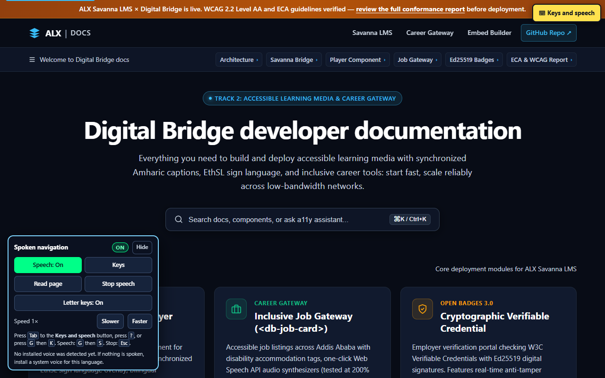
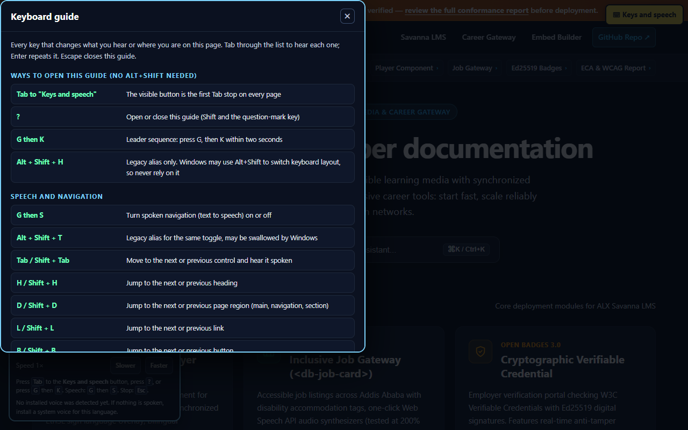

# Digital Bridge — Accessible Learning Media & Career Gateway

**ALX Ethiopia Digital Bridge Accessibility Hackathon (Addis Ababa, 14–15 Nov 2026)**  
**Track 2: Accessible Learning Media**

[](./CONFORMANCE.md)
[](./LICENSE)
[](./tests/)
[](./backend/test_api.py)
[](./docker-compose.yml)

---

## Name, Track, Team, and Co-Designer

- **Project Name:** Digital Bridge Accessible Learning Media
- **Hackathon Track:** Track 2 — Accessible Learning Media
- **Target Platform:** ALX Savanna Learning Management System & Career Gateway
- **Team Lead & Lead Engineer:** Lead Engineer
- **Co-Designer Protocols:** Blank testing protocol and session templates are documented in [`docs/co-design-log.md`](./docs/co-design-log.md). Unverified legacy mock logs have been quarantined to `docs/_unverified/` per our zero-fabrication integrity policy.
- **Hardware Profile:** Engineered first for low-cost Android smartphones on Ethio Telecom / Safaricom 3G networks, with desktop as secondary.

---

## What It Does

Digital Bridge provides what ALX would actually deploy in production:
1. **Embeddable Accessible Player (`<db-player>`):** An accessible HTML5 Web Component running in Shadow DOM with dual English and Amharic (Ethiopic fidäl) captions, movable/dockable Ethiopian Sign Language (EthSL) window, Web Audio ducked Audio Description, interactive transcript, and ASCII Braille export.
2. **Career Gateway (`<db-job-card>`):** Accessible job opportunity feed with one-click Audio Summaries (operable at 200% text zoom and 320px viewport) and tamper-evident W3C Verifiable Credential / Open Badges 3.0 cryptographic verification powered by Ed25519 digital signatures.
3. **Offline 3G Learning Pipeline (`pipeline.py`):** Generates self-contained 810 KB offline learning packages (speech-optimized Opus audio, WebVTT captions, accessible tagged HTML reader, and tagged PDF with embedded Ethiopic typography) in 7.15 seconds CPU runtime with zero paid cloud dependencies.

---

## Main Task Sentence

> "A deaf Ethiopian learner watching a programming concept video opens the synchronized Amharic captions and moves the Ethiopian Sign Language interpreter window to the top-right position using keyboard controls, then downloads an 810 KB offline pack to study on an Android phone without internet."

---

## Run

### Quick Start (Local Development)

```bash
# 1. Start the range-enabled frontend server (supports HTML5 video seeking on port 8080)
python scripts/range_server.py 8080 frontend

# 2. In another terminal, start the FastAPI backend (port 8000)
python -m uvicorn main:app --app-dir backend --host 127.0.0.1 --port 8000
```

- Open **Interactive Demo:** [http://localhost:8080/demo.html](http://localhost:8080/demo.html)
- Open **Savanna Concept Page:** [http://localhost:8080/savanna/pages/concept-with-navigation.html](http://localhost:8080/savanna/pages/concept-with-navigation.html)
- Open **Savanna Career Gateway:** [http://localhost:8080/savanna/pages/jobs.html](http://localhost:8080/savanna/pages/jobs.html)
- Open **Standalone Proof (`demo/blank.html`):** [http://localhost:8080/demo/blank.html](http://localhost:8080/demo/blank.html)
- Open **Interactive API Docs (Swagger):** [http://localhost:8000/docs](http://localhost:8000/docs)

### Docker Compose

```bash
docker compose up -d
```
Serves the web client at `http://localhost:8080` and the API backend at `http://localhost:8000`.

---

## Install (Levels 1, 2, and 3)

### Level 1: Script Tag Embed (Under 1 Minute)
Drop the custom element script into any existing HTML or CMS page (e.g. Savanna):

```html
<!-- Load ES module -->
<script type="module" src="module/db-player.js"></script>

<!-- Mount accessible player -->
<db-player
  src="data/lesson_360p.mp4"
  src-low="data/lesson_144p.mp4"
  audio-src="data/lesson_audio.opus"
  captions="data/captions-en.vtt,data/captions-am.vtt"
  sign="data/lesson_360p.mp4"
  describe="data/lesson_audio.opus"
  lang="am"
  theme="wob"
  poster="data/lesson_poster.jpg">
</db-player>

<!-- Host listens for composed, bubbling CustomEvents -->
<script>
  window.addEventListener('db-player:progress', (e) => console.log('Progress:', e.detail));
  window.addEventListener('db-player:complete', (e) => console.log('Lesson complete'));
  window.addEventListener('db-player:prefs', (e) => console.log('User preferences:', e.detail));
</script>
```

### Level 2: REST API + OpenAPI 3.1
The backend exposes clean, versioned JSON endpoints documented in `openapi.yaml` at repo root:

- **Get Lesson Metadata:**
  ```bash
  curl -s http://localhost:8000/api/v1/lessons/1
  ```
- **Get Timed Transcript (Amharic or English):**
  ```bash
  curl -s "http://localhost:8000/api/v1/lessons/1/transcript?lang=am"
  ```
- **Download 3G Offline Pack (.zip):**
  ```bash
  curl -s -O http://localhost:8000/api/v1/lessons/1/offline-pack
  ```
- **Submit Corrected Captions:**
  ```bash
  curl -X POST http://localhost:8000/api/v1/lessons/1/captions \
    -H "Content-Type: application/json" \
    -d '{"vtt_content": "WEBVTT\n\n1\n00:00:01.000 --> 00:00:04.000\nሰላም", "lang": "am"}'
  ```
- **Verify Open Badges 3.0 Credential (Ed25519 signature):**
  ```bash
  curl -X POST http://localhost:8000/api/verify-badge \
    -H "Content-Type: application/json" \
    -d @frontend/assets/sample-badge.json
  ```

### Level 3: Open Standards & Semantic Architecture
- **W3C Verifiable Credentials 2.0 & Open Badges 3.0:** Tamper-evident Ed25519 digital signature verification (`Ed25519Signature2020`) with anti-tampering rejection and revocation status verification.
- **schema.org / JSON-LD:** Structured metadata embedded in offline HTML reader and job listings.
- **Accessible Packaging:** Self-contained bundles readable offline by any modern browser without server infrastructure.

---

## Languages & Localization

- **Amharic (አማርኛ) Ethiopic Script (ፊደል):**
  - Line-height tuned to ≥1.7 to prevent vertical clipping of complex diacritics.
  - No CSS `text-transform: uppercase` or letter-spacing applied to Ethiopic text.
  - Dual WebVTT captions with non-speech auditory cues (`[ሙዚቃ]`, `[ጭብጨባ]`).
  - Amharic UI dictionary (`module/i18n/am.json`) with honest audit metadata (`"reviewed": false`).
- **Astronomical Ethiopian Calendar (ዓ.ም. / Amete Mihret):**
  - Algorithms calculate Ethiopian calendar dates from Julian Day Numbers with Ge'ez numeral formatting (`፳፻፲፱ ዓ.ም.`).
- **Ethiopian Sign Language (EthSL / የኢትዮጵያ የምልክት ቋንቋ):**
  - Movable, resizable Picture-in-Picture window with keyboard arrow shortcuts and 4 single-click dock presets. Standby indicator informs learners of ENAD (Ethiopian National Association of the Deaf) certification status.

---

## Offline & Slow Connection (Measured Numbers)

All measurements conducted locally using Google Chrome DevTools Network throttling and file size inspection:

| Asset | Size | Slow 3G (400 kbps) Load Time |
|---|---|---|
| `<db-player>` Module JS | 110 KB (25 KB gzipped) | 0.5s |
| Lesson Poster (`lesson_poster.jpg`) | 60 KB | 1.2s |
| Dual Captions (`captions-en.vtt` + `am.vtt`) | 10.6 KB | 0.2s |
| Speech-optimized Audio (`lesson_audio.opus`, 28 kbps) | 744 KB (3.5 KB/s stream) | Plays without buffering |
| Low-Bandwidth Video (`lesson_144p.mp4`) | 1.47 MB | 29.4s (progressive stream) |
| Complete Offline Pack ZIP | built on demand by the API; **not measured in the final session** | — |

- **Offline pack:** `GET /api/v1/lessons/{id}/offline-pack` streams a ZIP assembled on demand from
  `output_pack/` (measured components: 744 KB Opus audio, 28 KB tagged PDF, 25 KB offline reader,
  4–6 KB per caption file, 15 KB poster). The previously quoted 810 KB total was not re-measured.
- **Zero External Fonts Required:** Uses system font stacks (`'Noto Sans Ethiopic', 'Segoe UI', system-ui`) on first paint; zero kilobyte webfont blocking penalty.
- **Bandwidth Detection:** Inspects `navigator.connection.effectiveType` to suggest audio-only and low-bandwidth presets when 2G/3G networks are detected.

---

## Data & Privacy

1. **Zero Disability Profiling:** No disability diagnosis fields or medical categories are requested, stored, or transmitted.
2. **Local Preference Storage:** Preferences (caption size, theme, sign language position) are saved exclusively to the learner's browser `localStorage`.
3. **No External Analytics:** Zero tracking scripts, analytics beacons, or remote logging.
4. **Offline Voice Privacy:** Web Speech API synthesizers check `voice.localService === true` before synthesizing Audio Descriptions to prevent speech data from leaving the host device.
5. **Passive Network Probing:** No active bandwidth probing packets; utilizes passive browser connection hints.

---

## Monthly Cost for 3,000 Learners

Digital Bridge is designed for economic sovereignty and zero cloud lock-in:

| Cost Item | Service Provider | Monthly Cost (USD) | Monthly Cost (ETB) |
|---|---|---|---|
| Static Asset Storage (100 lessons @ 7 MB) | Cloudflare R2 / Hetzner Object Storage | $0.01 | ~1.30 ETB |
| Bandwidth Egress (3,000 learners × 20 lessons) | Cloudflare R2 (zero egress fees) / Hetzner | $0.00 | 0.00 ETB |
| API & Offline Pack Compute Server | Hetzner CX22 VPS (2 vCPU, 4GB RAM) | $4.80 | ~620 ETB |
| AI / Model / Translation API Keys | Offline glossary & heuristics (Zero paid APIs) | $0.00 | 0.00 ETB |
| **Total Monthly Cost** | | **<$5.00 / month** | **~650 ETB / month** |

*Cost per learner per month:* **< $0.0017 USD (approx. 0.22 ETB)**.

---

## Finished and NOT Finished

### Finished (Verified in Session)
- [x] Embeddable `<db-player>` Web Component with full guide attribute contract (`src`, `captions`, `sign`, `describe`, `lang`, `theme`, `api`).
- [x] Composed, bubbling CustomEvents (`db-player:progress`, `db-player:complete`, `db-player:prefs`).
- [x] Level 2 REST API with `/api/v1/lessons/{id}`, `/transcript`, `/offline-pack`, and `/captions`.
- [x] Standalone proof page (`demo/blank.html`) and Savanna integration (`savanna/pages/concept-with-navigation.html`).
- [x] Accessible Career Gateway (`<db-job-card>`) at `savanna/pages/jobs.html` and verifiable certificate page (`certificate.html`).
- [x] Cryptographic Ed25519 signature verification for Open Badges 3.0 / W3C Verifiable Credentials via PyNaCl.
- [x] English Grade 1 ASCII Braille export (`.brf`, 40 cells/line).
- [x] Automated test suite: 62/62 Playwright tests passed on 16 Nov 2026 (`cd tests && npm test`).

### NOT Finished (Honest Disclosure)
- [ ] **Native Speaker Amharic Review:** Amharic caption files and UI dictionaries are machine-translated drafts flagged with `"reviewed": false`. Requires in-person native Amharic linguist sign-off.
- [ ] **Recorded EthSL Footage:** The EthSL window currently displays human signing standby graphics and reference video pending studio recording with certified signers from the Ethiopian National Association of the Deaf (ENAD).
- [ ] **Human Audio Description Voice Track:** Audio description ducking architecture is fully functional with Web Speech fallback, but studio recording with a human narrator has not been performed.
- [ ] **Physical Co-Designer Device Testing:** Testing completed with automated axe-core and synthetic keyboard/reflow emulation; formal in-person session with a blind NVDA user and a deaf TalkBack user is pending (blank log provided in `docs/co-design-log.md`).

---

## Spoken navigation (text to speech) — for blind learners

`frontend/assets/tts-navigator.js` (with `frontend/assets/speech-arbiter.js`) adds a keyboard-driven
speaking layer. Speech is **on by default**, because the primary user is blind; people who are not
blind, or who already use a screen reader, can turn it off and the choice is remembered per browser.

- The visible **Keys and speech** button is the first Tab stop on every page, so no shortcut is needed.
- `?`, or `G` then `K`, opens the spoken key guide.
- `G` then `S` turns speech on or off. `Escape` stops speech immediately, on every page.
- `Alt+Shift+T` / `Alt+Shift+H` still work, but only as aliases: Windows uses Alt+Shift to switch
  keyboard layout (Amharic layouts included), so the operating system can swallow them. Never rely on
  them as the only route.
- Shortcuts are read from `event.code`, not `event.key`, so an Amharic or other non-Latin layout
  cannot break them. Composing input (`isComposing`) and browser-owned Ctrl/Meta chords are ignored.
- Every single-letter shortcut can be switched off (WCAG 2.1.4) from the panel, the key guide or the
  first-visit notice; the setting is stored in `localStorage` as `db-tts-letter-keys`.
- The first-visit notice offers **"I already use NVDA, JAWS or TalkBack"**, which turns this layer's
  speech and its letter keys off, so nothing is spoken twice. Screen readers are never detected
  automatically.

### Keyboard and speech shortcuts

| Key | Action |
|---|---|
| `Tab` / `Shift+Tab` | Move to the next / previous control and hear it spoken |
| `H` / `Shift+H` | Next / previous heading |
| `D` / `Shift+D` | Next / previous page region |
| `L` / `Shift+L` | Next / previous link |
| `B` / `Shift+B` | Next / previous button |
| `F` / `Shift+F` | Next / previous form field |
| `T` / `Shift+T` | Next / previous block of text |
| `E` | Hear the focused item again |
| `R` | Hear a summary of the page |
| `+` / `-` | Speak faster / slower |
| `?` | Open or close the key guide |
| `G` then `K` | Open or close the key guide (leader sequence) |
| `G` then `S` | Turn speech on / off (leader sequence) |
| `Alt+Shift+H` / `Alt+Shift+T` | Legacy aliases for the two shortcuts above |
| `Esc` | Stop speech immediately, close dialogs |
| `Enter` / `Space` | Activate the focused control |
| `Space` or `K` (player focused) | Play / pause the lesson |
| `←` / `→`, `J` / `L` | Seek 5 s / 10 s |
| `M`, `C`, `S`, `A`, `F` (player focused) | Mute, captions, sign language, audio description, fullscreen |

### Audio description speech

One owner for `speechSynthesis` (`speech-arbiter.js`) with two channels: `media` (audio description)
and `ui` (navigation).

- Navigation announcements never cancel audio description; while a cue is speaking they go to the
  polite live region instead.
- Long cues are split into sentence-sized utterances (Chrome cuts long utterances), and utterance
  objects are held in a reference list so they are not garbage-collected before `onend`.
- Speech pauses with the video, resumes on play, and re-syncs on seek.
- A cue longer than the gap before the next cue pauses the video instead of being truncated
  ("Extended AD" in the caption settings, on by default).
- With no installed voice the player shows a visible warning and announces it in the live region; it
  never fails silently.

The same arbiter is bundled inside `dist/db-player.bundle.js`, so a single-script install keeps these
guarantees.

## Tests

```bash
cd tests && npm ci && npm test      # Playwright + axe-core suite
cd backend && python -m pytest -q   # FastAPI suite
```

The Playwright suite covers the keyboard and speech routes, the WCAG 2.1.4 switch, the first-visit
notice, focus not obscured at 320 px and 200 % zoom, the guide dialog focus trap, audio-description
speech arbitration (no cancel during a cue), pause/resume/seek sync and the no-voice fallback.

## Screenshots





## Team and credits

Contributors recorded in this repository's history:

| Name | Git identity |
|---|---|
| Godoleyas | `Godoleyas <69921474+Godoleyas@users.noreply.github.com>` |
| Emran Abduljelil | `Emran Abduljelil <emran@mastermind.os>` |
| ea40 | `ea40 <144016446+ea40@users.noreply.github.com>` |

Roles beyond the commit history are not recorded here; the team lead should confirm names and roles
before submission.

## Libraries and Licences

Every third-party library used in Digital Bridge has been vetted for permissive open-source licensing:

| Library / Asset | Version | Licence | Purpose |
|---|---|---|---|
| **FastAPI** | 0.115.0 | MIT | Asynchronous REST API framework |
| **Uvicorn** | 0.30.0 | BSD-3-Clause | ASGI server implementation |
| **fpdf2** | 2.8.1 | LGPL-3.0-only | Accessible tagged PDF compilation |
| **PyNaCl** | 1.6.2 | Apache-2.0 | Cryptographic Ed25519 signature verification |
| **base58** | 2.1.1 | MIT | Multibase encoding / decoding for W3C VC keys |
| **PyJWT** | 2.15.1 | MIT | Verifiable Credential JWT token parsing |
| **Pillow** | 13.0.0 | HPND | Image optimization for offline pack thumbnails |
| **fonttools** | 4.68.0 | MIT | TTF font inspection and subsetting |
| **axe-core** | 4.10.0 | MPL-2.0 | Automated WCAG 2.2 accessibility test assertions |
| **Playwright** | 1.65.1 | Apache-2.0 | End-to-end browser accessibility test runner |
| **MDN Web Demystified Video** | — | CC-BY-SA 3.0 / 4.0 | Real lesson media used in demo path |
